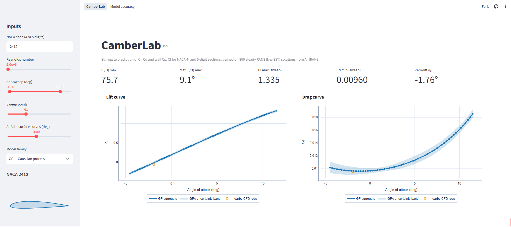
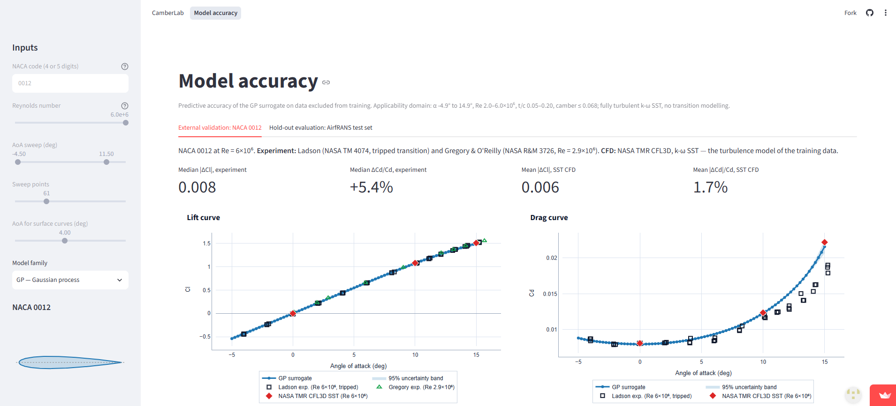

<h1 align="center">CamberLab</h1>

<p align="center">
  <strong>Surrogate models for NACA aerofoil aerodynamics</strong>
</p>

<p align="center">
  <a href="#license"></a>
  
  
  
  
</p>

---

CamberLab replaces a ~25-minute steady RANS simulation with a surrogate call
that takes milliseconds:

```text
(angle of attack, Reynolds number, NACA section) → (Cl, Cd, L/D, Cp(x/c), Cf(x/c))
```

Live demo: <https://camberlab.streamlit.app/>

The surrogates are trained on **AirfRANS** (Bonnet et al., NeurIPS 2022):
1,000 steady 2D incompressible RANS simulations (OpenFOAM, k-ω SST) of NACA 4-
and 5-digit aerofoils at Re 2–6×10⁶ and α −5° to 15°. CamberLab regresses the
force coefficients and wall distributions directly from section geometry and
flow conditions, rather than predicting the flow field and integrating it. On
the 200 held-out AirfRANS test cases the Gaussian-process surrogate reaches
R² = 0.9993 on Cl and 0.981 on Cd (median drag error 0.6%), and on NACA 0012
at Re 6×10⁶ it reproduces the NASA TMR k-ω SST solution to within 1.7% in Cd.

## Features

- **Any NACA 4- or 5-digit section** (standard and reflex 5-digit mean lines).
  Geometry features are computed by the same code from the CFD mesh wall at
  training time and from the analytic section at query time.
- **Four surrogate families**: Gaussian process (GP), random forest (RF),
  multilayer perceptron (MLP) and Kriging (KRG, SMT), each fitted for Cl and
  log Cd.
- **Wall distributions.** Cp(x/c) and signed Cf(x/c) on both surfaces
  (Cf < 0 marks reversed flow), predicted as PCA mode weights by the same
  families. The CFD wall data behind them reproduces AirfRANS' C_L and C_D
  to within 2.7% on every sample.
- **Calibrated uncertainty.** GP and KRG report a 95% prediction interval;
  the GP interval contains 95% of the held-out test values.
- **Explicit applicability domain.** Queries outside the training range are
  answered with a warning, never silently.
- **Two-page interactive app** (below).

## Application

The Streamlit app has two pages that share one input panel (NACA code, Re,
α sweep, model family).

| Page | Content |
|---|---|
| **CamberLab** | Lift, drag, efficiency (L/D) and drag-polar curves over the α sweep with 95% prediction intervals; nearby training solutions (±8% Re, ±0.01 t/c, ±0.01 camber) for context; Cp and Cf distributions at a chosen α; tabulated predictions as CSV. |
| **Model accuracy** | *External validation:* NACA 0012 at Re 6×10⁶ against Ladson's and Gregory & O'Reilly's experiments and the NASA TMR CFL3D k-ω SST solution (Cl, Cd, Cp, Cf). *Hold-out evaluation:* parity and residual-vs-α plots on the 200 AirfRANS test cases, and all four families compared on the same cases. Only the model family is editable on this page; the section is fixed to NACA 0012. |

<p align="center">
  
  
</p>

## Quickstart

### Run the app

```bash
git clone https://github.com/saifrehman945/CamberLab.git
cd CamberLab
curl -LsSf https://astral.sh/uv/install.sh | sh    # if uv is not installed
uv venv && uv pip install -r requirements.txt
uv run streamlit run app.py
```

The app and CLI only need the committed `models/full/` artifacts (~150 MB)
and the evaluation outputs in `results/`, not the dataset. Surface curves ship for the GP and MLP families; KRG and RF
curve models are too large to commit and must be trained locally.

### Predict from the command line

```bash
uv run python scripts/predict.py --alpha 4 --re 3e6 --naca 2412 --family all
uv run python scripts/predict.py --alpha 4 --re 3e6 --naca 2412 --surface --surface-csv cp_cf.csv
uv run python scripts/11_sweep_curves.py --naca 23012 --re 4e6     # α sweep → CSV + PNG
```

### Rebuild everything from the data

Download AirfRANS once (the clipped variant, ≈ 18 GB on disk; code never
downloads it for you):

```bash
huggingface-cli download PLAID-datasets/AirfRANS_clipped \
  --repo-type dataset --local-dir data/airfrans_clipped
```

Then run the pipeline (about 4 hours on a laptop with 8 GB RAM, mostly
curve-model training; reading the data needs ~2 GB):

```bash
uv run python scripts/airfrans/inspect_dataset.py    # checks the data (Gate 2), ~35 min
uv run python scripts/20_ingest_airfrans.py          # → dataset.csv + wall Cp/Cf curves, ~20 min
uv run python scripts/21_qa_airfrans.py              # → results/airfrans_qa.md
uv run python scripts/22_make_splits.py              # official AirfRANS splits
uv run python scripts/23_surface_gate.py             # wall data reproduces C_L/C_D?
uv run python scripts/09_train_surrogates.py --task all                    # Cl/Cd + curves
uv run python scripts/10_global_validation.py        # → test metrics and per-case predictions
uv run pytest
```

`09_train_surrogates.py --outputs coeffs` trains only the Cl/Cd models
(~12 min).

Use `--data-dir` or `AIRFRANS_DIR` if the data lives elsewhere.

## Results

All numbers are on data excluded from training and hyper-parameter
selection. The full write-up is [`results/airfrans_report.md`](results/airfrans_report.md).

### Hold-out evaluation (AirfRANS 800/200 split)

The official `full` split: 800 training and 200 test simulations. Errors are
relative to the AirfRANS k-ω SST solutions; the median relative error is
reported because the mean diverges for Cl near zero.

| Model | R² Cl | R² Cd | Median rel. err. Cl | Median rel. err. Cd | P90 rel. err. Cd | 95% PI coverage |
|---|---|---|---|---|---|---|
| **GP** | 0.9993 | 0.9806 | 1.07% | 0.59% | 2.5% | 95% |
| **KRG** | 0.9993 | 0.9872 | 0.90% | 0.71% | 3.2% | 82% |
| **MLP** | 0.9984 | 0.9785 | 1.86% | 1.83% | 6.5% | — |
| **RF** | 0.9921 | 0.9492 | 4.59% | 3.04% | 11.8% | — |

GP is the default: its accuracy matches KRG and its 95% interval is
calibrated, whereas the KRG interval is too narrow. Wall distributions (GP):

| Quantity | R² (station mean) | RMSE | ±2σ coverage | Separation |
|---|---|---|---|---|
| Cp(x/c) | 0.989 | 0.062 | 96% | — |
| Cf(x/c) | 0.966 | 8.5×10⁻⁴ | 96% | detected in 97% of cases, x/c error 0.015 |

The separation-point error is set by the 20-mode PCA truncation (~0.015 c);
for Cp and overall Cf the regressors, not the modes, set the error.

<p align="center">
  
</p>

### External validation (NACA 0012, Re 6×10⁶)

GP predictions against data from outside AirfRANS:

| Reference | ΔCl | ΔCd/Cd |
|---|---|---|
| NASA TMR CFL3D, k-ω SST (α = 0°, 10°, 15°) | 0.006 (mean abs.) | 1.7% (mean abs.) |
| Ladson, NASA TM 4074 (tripped, −4° to 15°) | 0.008 (median abs.) | +5.4% (median) |

Agreement with the SST solution measures surrogate error; the drag excess
over experiment is that of fully turbulent SST and is inherited from the
training data. Predicted Cp and Cf follow the TMR solution, including the
suction peak:

<p align="center">
  
</p>

### Extrapolation in Reynolds number

On the AirfRANS `reynolds` task (training Re 3–5×10⁶), GP and KRG over-predict
Cd by up to 2.6× and 4.6× for a few thin, cambered sections at negative α
below Re 3×10⁶; RF and MLP stay within 1.27×. The GP marginal likelihood has
a second optimum with the Re trend reversed, so this task is sensitive to the
fit (report, failure mode 1). The four official AirfRANS tasks (`full`,
`scarce`, `reynolds`, `aoa`), evaluated with the AirfRANS paper's metrics,
are tabulated in [`results/airfrans_benchmark.md`](results/airfrans_benchmark.md).

## How it works

1. **Ingest.** Each AirfRANS sample stores α, U∞, C_L and C_D as scalars. The
   aerofoil wall is recovered from the mesh as the boundary loop off the outer
   clip box, and reduced to four section features: max thickness `t_max` and
   its location `x_tmax`, max camber `m_max` and its location `x_m`. Re =
   U∞·c/ν with c = 1 m and ν at 298.15 K. Along the wall, Cp comes from the
   stored pressure, and the wall shear stress (not stored) from the velocity
   gradient in the wall cells. Both are resampled to 101 x/c stations per
   surface. A gate checks that integrating them reproduces the stored C_L
   and C_D (median error 0.00% and 1.7%).
2. **QA.** Hard physical checks (0 of 1,000 rows fail), lift-slope and
   zero-lift-angle sanity checks, leave-one-out GP outlier screening (10 rows
   listed, none dropped), and a near-NACA0012 comparison against Ladson's
   experiment and NASA TMR CFL3D SST. See
   [`results/airfrans_qa.md`](results/airfrans_qa.md).
3. **Split.** The official AirfRANS task memberships, read from the dataset
   card, are frozen in `splits/`. Test rows are used once, for evaluation only.
4. **Train.** Inputs `[α, log10 Re, t_max, x_tmax, m_max, x_m]` are
   standardised. The targets are Cl and log Cd. RF leaf size and MLP
   early-stopping patience are chosen by 5-fold CV on the training rows.
   Cp and Cf curves are compressed to 20 PCA modes each (fitted on training
   rows), and the families predict the mode weights.
5. **Query.** For a NACA code, the section is generated analytically (Abbott &
   von Doenhoff) and passed through the same feature extractor, so query
   features match training features.

## Limitations

- **Envelope:** Re 2–6×10⁶, α −5° to 15°, NACA 4- and 5-digit sections only
  (t/c ≈ 0.05–0.20, camber up to ~7%). Outside it you get a warning and an
  extrapolation.
- **Fully turbulent SST, no transition.** Cd is biased high against tripped or
  free-transition experiments at the lower Re values: +10–25% vs Ladson's
  NACA 0012 data (Re 6×10⁶) for cases at Re 2–3×10⁶, within a few percent
  at 6×10⁶.
- **Near stall** (α > ~12°), steady RANS is the least reliable part of the
  data, and the surrogate inherits that.
- **The surrogate can be no more accurate than AirfRANS' own CFD.**
- **Surface curves:** don't integrate predicted Cp/Cf for drag (errors of
  6–8% even for GP, since drag is a small residual of large pressure forces);
  use the direct Cd model. The computed wall shear stress runs ~2.5% high
  against AirfRANS' own drag. Near stall, PCA slightly smooths
  plateau-shaped features.
  

## Repository layout

```text
CamberLab/
├── app.py                        # Streamlit entrypoint: navigation and shared inputs
├── app_pages/                    # CamberLab (prediction) and Model accuracy pages
├── scripts/
│   ├── airfrans/                 # dataset I/O, geometry, wall Cp/Cf, inspection, plot style
│   ├── 20_ingest_airfrans.py     # samples → results/airfrans_dataset.csv
│   ├── 21_qa_airfrans.py         # hard/soft QA, reference comparison
│   ├── 22_make_splits.py         # frozen official splits → splits/
│   ├── 23_surface_gate.py        # wall Cp/Cf vs stored C_L/C_D
│   ├── 09_train_surrogates.py    # GP / RF / MLP / KRG per task (Cl/Cd + curves)
│   ├── 10_global_validation.py   # test metrics, per-case predictions, plots
│   ├── 11_sweep_curves.py        # α sweep for one section
│   ├── predict.py                # single-point CLI
│   └── surrogate/                # data schema, model families, curves, inference API
├── models/full/                  # committed models (other tasks: regenerate)
├── splits/                       # frozen train/test indices + provenance
├── results/                      # dataset, QA, metrics, benchmark, figures, report
├── validation_data/              # Ladson / NASA TMR reference data
├── tests/                        # geometry, schema, reload, CLI, app
├── legacy/regime_v1/             # retired regime-aware OpenFOAM pipeline
└── data/                         # AirfRANS download (gitignored)
```

## Legacy pipeline

CamberLab originally generated its own OpenFOAM 12 dataset with a four-regime
design (per-regime turbulence models, meshes and validation). That pipeline is
archived, with its history, in [`legacy/regime_v1/`](legacy/regime_v1/).

## Contributing

Issues and pull requests are welcome. Please read [`CLAUDE.md`](CLAUDE.md)
first; it is the development guide for this repo. The essentials:

- Work inside the uv virtual environment; dependencies come from PyPI.
- Never edit, drop or fabricate rows of `results/airfrans_dataset.csv`. QA
  outcomes live in `results/airfrans_qa_flags.csv`.
- Never use test indices for fitting or tuning; use 5-fold CV on train.
- Compute query geometry only via `naca_coordinates` + `section_features`.
- `pathlib`, `logging`, `joblib`, seed 42.

## Citation and data licence

The training data is AirfRANS, © Safran, distributed under the
[Open Database License (ODbL 1.0)](https://opendatacommons.org/licenses/odbl/1-0/)
via [`PLAID-datasets/AirfRANS_clipped`](https://huggingface.co/datasets/PLAID-datasets/AirfRANS_clipped).
If you use CamberLab's models or derived data, please cite:

```bibtex
@inproceedings{bonnet2022airfrans,
  title     = {{AirfRANS}: High Fidelity Computational Fluid Dynamics Dataset for
               Approximating {R}eynolds-Averaged {N}avier--{S}tokes Solutions},
  author    = {Bonnet, Florent and Mazari, Ahmed Jocelyn and Cinnella, Paola and
               Gallinari, Patrick},
  booktitle = {Advances in Neural Information Processing Systems (NeurIPS),
               Datasets and Benchmarks Track},
  year      = {2022},
  eprint    = {2212.07564},
  archivePrefix = {arXiv}
}
```

## License

Code is released under the MIT License. See [`LICENSE`](LICENSE). The AirfRANS
data and databases derived from it (including `results/airfrans_dataset.csv`
and `results/airfrans_wall_curves.npz`) remain under the ODbL.
